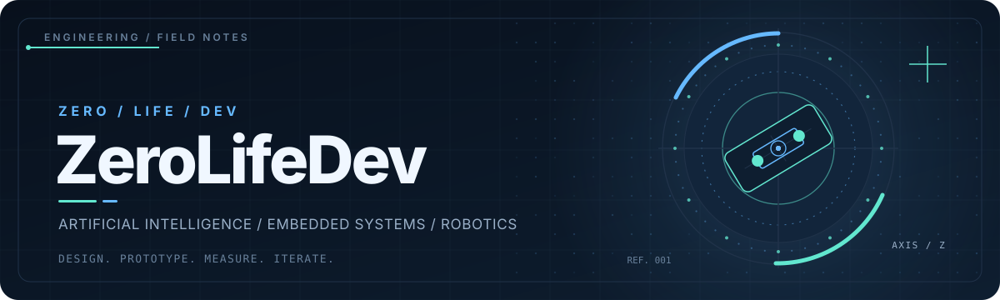
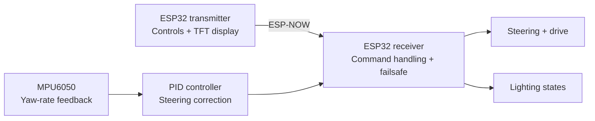

<!-- ZeroLifeDev / Profile README -->
<div align="center">
  <picture>
    <source media="(prefers-color-scheme: dark)" srcset="./assets/hero-dark.svg" />
    <source media="(prefers-color-scheme: light)" srcset="./assets/hero-light.svg" />
    
  </picture>
</div>

<p align="center">
  <strong>From software to sensors to things that actually move.</strong><br/>
  Building experimental systems at the intersection of AI, low-level control, and mechanical engineering.
</p>

<p align="center">
  <a href="#selected-projects">Projects</a> &nbsp;·&nbsp;
  <a href="#inside-the-system">Architecture</a> &nbsp;·&nbsp;
  <a href="#engineering-stack">Stack</a> &nbsp;·&nbsp;
  <a href="#research-horizon">Research</a>
</p>

---

### `01 / ABOUT THE LAB`

I work across multiple layers of a system, from **Python infrastructure** and **C++ firmware** to wireless communication, control algorithms, and mechanical prototypes. I'm especially interested in how intelligence becomes *action*: turning a signal, a model, or a control loop into something physical.

```text
INTERESTS     AI / VOICE SYSTEMS / EMBEDDED FIRMWARE / ROBOTICS
HARDWARE      ESP32 / IMUs / MOTOR CONTROL / CUSTOM ELECTRONICS
WORKFLOW      PROTOTYPE → INSTRUMENT → TEST → ITERATE
```

<a id="selected-projects"></a>
### `02 / SELECTED PROJECTS`

<table>
<tr>
<td width="50%" valign="top">
  <h3>📡 Drift Sync</h3>
  <p><strong>Dual-MCU RC control platform</strong> · <code>IN DEVELOPMENT</code></p>
  <p>A custom <strong>1:10 RC platform</strong> centered on two ESP32 microcontrollers and <strong>ESP-NOW</strong> communication, with an emphasis on responsive controls and feedback.</p>
  <ul>
    <li>Handheld TX with <code>TFT_eSPI</code> dashboard and digital trim</li>
    <li>RX control for motors, lighting, and fail-safe behavior</li>
    <li>Live telemetry and yaw-rate stabilization experiments</li>
  </ul>
  <p><code>ESP32</code> <code>C++</code> <code>ESP-NOW</code> <code>MPU6050</code> <code>PID</code></p>
</td>
<td width="50%" valign="top">
  <h3>🧠 Clara</h3>
  <p><strong>Modular voice-AI infrastructure</strong> · <code>IN DEVELOPMENT</code></p>
  <p>Exploring a Python-based architecture for streaming audio and adaptable AI service integrations.</p>
  <ul>
    <li>Modular processing stages</li>
    <li>Audio streaming and pipeline orchestration</li>
    <li>Pluggable API integrations</li>
  </ul>
  <p><code>Python</code> <code>Streaming Audio</code> <code>APIs</code></p>
</td>
</tr>
<tr>
<td colspan="2" valign="top">
  <h3>⚙️ Hackintoshify</h3>
  <p><strong>macOS installer workflow automation</strong> · <code>IN DEVELOPMENT</code></p>
  <p>A utility aimed at reducing manual steps involved in preparing hardware-specific macOS installation media, including hardware detection, EFI preparation, and legacy/UEFI configuration workflows.</p>
  <p><code>Systems Automation</code> <code>Hardware Detection</code> <code>Boot Configuration</code></p>
</td>
</tr>
</table>

<a id="inside-the-system"></a>
### `03 / INSIDE THE SYSTEM`

**Drift Sync: control architecture (prototype design)**



<table>
<tr>
<td width="50%" valign="top">
  <p><strong>01. Closed-loop control</strong></p>
  <p>Exploring <strong>yaw-rate-based drift correction</strong>: measure rotational motion with the MPU6050, compute a PID correction, and blend that correction with steering input.</p>
  <p><code>SENSING → ESTIMATION → CORRECTION</code></p>
</td>
<td width="50%" valign="top">
  <p><strong>02. Mechanical actuation</strong></p>
  <p>Experimenting with <strong>miniaturized automotive-inspired suspension geometry</strong> and independent servo-driven ride-height control using four SG90 servos.</p>
  <p><code>GEOMETRY → ACTUATION → TESTING</code></p>
</td>
</tr>
</table>

<a id="engineering-stack"></a>
### `04 / ENGINEERING STACK`

**Primary tools and technologies**

<p>
  
  
  
  
  
  
</p>

| Domain | Tools |
|:--|:--|
| **AI & software** | Python, streaming pipelines, Jupyter, API integrations |
| **Firmware & hardware** | C++, Arduino IDE, ESP32, I²C, SPI, ESP-NOW |
| **Web & services** | JavaScript, TypeScript, HTML/CSS, Firebase |
| **3D & mechanical** | Blender, CAD workflows, mechanical prototyping |
| **Development** | Git, GitHub, VS Code, Linux |

<details>
<summary><b>Other languages and platforms I'm exploring</b></summary>
<br/>
C#, Java, Kotlin, Dart, PHP, Shell, PostgreSQL, Autodesk Maya, and 3ds Max.
</details>

<a id="research-horizon"></a>
### `05 / RESEARCH HORIZON`

**Artificial consciousness and self-modeling** · `FUTURE INTEREST`

Long-term curiosity about machine awareness, computational models of self-representation, and what it would take to rigorously test claims about conscious systems. **Not an active research project yet.**

---

<p align="center">
  <sub>Build the prototype. Measure what happens. Make the next version better.</sub>
  <br/>
  <a href="https://github.com/ZeroLifeDev?tab=repositories"><b>Explore the repositories ↗</b></a>
</p>
